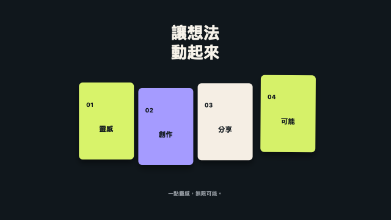

# 動畫小工坊 · Motion Workshop

**讓 Claude 在做網站、軟體介面與影片時，直接參考可執行的動畫效果。**

40 種 Canvas / WebGL 效果、10 種場景轉場、Claude skill、技法拆解、可操作的網站範例，以及可選用的繁體中文 macOS 編輯器。離線運作，沒有 API 金鑰、CDN 或 npm 套件依賴。MIT 授權，可修改與商用，散布程式碼時保留授權。



[English](README.en.md) · [40 種效果預覽](docs/GALLERY.md) · [技法拆解](.claude/skills/motion-workshop/references/effect-breakdown.md) · [Claude skill](.claude/skills/motion-workshop/SKILL.md)

## 1.3 版：從效果到完整故事

- **8 套故事範本**：產品發表、App 介紹、數據報告、概念解說、文字集錦、品牌形象、軟體更新、直式短影音。客製品牌、標題、重點、配色、比例及 12／15／20／30 秒精確總長。
- **效果探索**：搜尋分類與標籤、收藏、排序、懸停／鍵盤聚焦的動態預覽；支援暫停與減少動態效果。
- **Claude 指令**：從整份作品或目前場景，產生網站／軟體／影片用途的指令，包含實際分鏡、效果 ID、配色與專案 JSON。可複製或存成 Markdown。
- **直接匯出 Skill ZIP**：Mac App 內含完整工具包，無須尋找本機路徑；效果拆解可查實際程式檔與參數。
- **復原／重做**：編輯與套用故事後可返回先前作品。

12 個新增 ID：line-chart、donut-chart、network-flow、timeline-story、code-window、terminal-run、logo-reveal、split-title、quote-card、gradient-mesh、isometric-stack、notification-stack。

## 30 秒開始

1. 按 GitHub **Code → Download ZIP** 並解壓縮，或 clone 這個儲存庫。
2. 在這個資料夾啟動 Claude Code。專案已包含 `.claude/skills/motion-workshop/SKILL.md`，可輸入 `/motion-workshop`。
3. 貼上你的需求，例如：

```text
/motion-workshop
請先讀效果目錄與相關程式碼，為我的產品網站設計三個重點卡片，
參考 card-flyin 的進場動作與 tab-indicator 的互動方式。
保留可閱讀的 HTML、鍵盤操作、暫停與減少動態效果支援。
請實作並驗證，不要只產生效果名稱。
```

Claude Code 的專案 skill 採上述資料夾位置；參見 [官方說明](https://code.claude.com/docs/en/skills)。只使用效果與網站範例不必安裝 macOS App。

## 安裝到另一個專案

從本儲存庫根目錄執行（Node.js 20+）：

```sh
node scripts/install-skill.mjs --project /absolute/path/to/your-project
```

目標專案必須已存在。腳本只複製完整 `motion-workshop` skill 到該專案的 `.claude/skills/`；不覆寫現有 skill，也不修改全域 Claude 設定。重新在目標專案啟動 Claude Code，使用 `/motion-workshop`。

也可以下載 [獨立 Skill ZIP](downloads/motion-workshop-skill.zip)，將裡面的 `motion-workshop` 整個資料夾放到目標專案的 `.claude/skills/`。全域使用者可自行放到 `~/.claude/skills/`。一般 Claude 網頁聊天可以閱讀上傳的 ZIP、協助撰寫程式／專案 JSON；實際執行與影片輸出取決於該環境能力。

## 直接試玩

雙擊 `.claude/skills/motion-workshop/assets/examples/website/index.html`。可以選擇 40 種效果、播放／暫停、逐格拖曳與下載 PNG。右下連結是實際 DOM 介面示範，包含鍵盤可操作的標籤、卡片進場與點擊回饋。

若瀏覽器限制本機檔案，從儲存庫根目錄執行：

```sh
npm run demo
# 瀏覽器開啟 http://127.0.0.1:4173，進入完整編輯器
```

完整編輯器可試用故事、收藏、Claude 指令與 PNG／JSON／Skill ZIP 匯出；瀏覽器版的 MP4 按鈕會提示使用 Mac App。獨立播放器位於 `/examples/website/index.html`。

不用 `npm install`。按 Ctrl+C 停止示範伺服器。若 4173 已被使用，設 `MOTION_DEMO_PORT=4174` 再執行。

## 動畫效果與轉場

| 類型 | 效果 ID |
|---|---|
| 文字 | type、mask-reveal、kinetic-zoom、text-morph、typewriter |
| 介面／卡片 | card-flyin、card-flip、orbit-cards、bento-grid、phone-scroll、tab-indicator、cursor-click |
| 資料／流程 | number-roll、chart-build、path-draw |
| 幾何／節奏 | bounce、morph、rhythm、beat-sync、physics |
| 質感／背景 | clay、flow、glass、tunnel、particles、reaction、halftone、glass-card |

轉場：`cut`、`crossfade`、`push`、`wipe`、`circle`、`zoom`、`slide-up`、`diagonal`、`blur`、`flash`。轉場期間前後兩幕都繼續運動；總長會扣除重疊時間。例：3 幕各 3 秒、兩次 0.6 秒轉場，合計 **7.8 秒**。

每個效果的參數、完整範例及預覽路徑都在 [catalog.json](.claude/skills/motion-workshop/assets/catalog.json)。[技法拆解](.claude/skills/motion-workshop/references/effect-breakdown.md) 說明算法、可調項目與應用方向。

## 網站、軟體與影片如何重用

| 用途 | 入口 | 可直接拿來用的內容 |
|---|---|---|
| 網站動畫 | [網站整合說明](.claude/skills/motion-workshop/references/web-ui.md) | 五個 runtime script、播放器、HTML / CSS 範例 |
| 真實介面動效 | [DOM 範例](.claude/skills/motion-workshop/assets/examples/software-ui/index.html) | 標籤切換、鍵盤行為、依序進場、點擊回饋 |
| 影片分鏡／剪輯 | [影片說明](.claude/skills/motion-workshop/references/video.md) | 可編輯 JSON、場景時間軸、同步逐格 API、macOS MP4 CLI |

不要把 Canvas 裡的示意手機、游標與標籤當作產品的真正互動控制項。程式碼可依技法改寫為產品介面；原生 SwiftUI / Flutter / React Native 需要相應移植。

## 讓 Claude 直接建立故事

```sh
node .claude/skills/motion-workshop/assets/create-project.mjs --list
node .claude/skills/motion-workshop/assets/create-project.mjs \
  --story product-launch --brand "你的品牌" --headline "讓想法被看見" \
  --items "簡單,清楚,流暢" --duration 15 --ratio 16:9 --output project.motion.json
```

跨平台、離線執行；已存在的檔案預設不覆寫。完整 [故事與指令說明](.claude/skills/motion-workshop/references/stories-and-prompts.md)。

## macOS 編輯器與 MP4

目前建置目標為 **Apple Silicon macOS**，需要 Xcode Command Line Tools；已驗證環境為 macOS 27。最低部署目標設定為 macOS 12，尚未在所有舊版系統驗證。

```sh
./build.sh
```

產生 `build/動畫小工坊.app`。將 App 移到 `~/Applications/`，開啟後即可選範本、編輯場景與轉場、匯出 PNG / JSON / MP4。建置採本機 ad-hoc 簽章，沒有 Apple Developer ID 公證；本倉庫主要提供可自行檢查與建置的原始碼。

自動輸出範例（先開 App）：

```sh
node .claude/skills/motion-workshop/assets/render.mjs \
  --project .claude/skills/motion-workshop/assets/examples/三幕轉場.motion.json \
  --output /absolute/path/to/movie.mp4
```

MP4 是無音訊 H.264，可手動匯入剪輯軟體再加旁白／音樂。專案自動儲存在 `~/Library/Application Support/動畫小工坊/project.json`；CLI 使用專用 jobs 佇列。這些使用者檔案不包含在儲存庫中。

## 限制與驗證

瀏覽器繪圖支援跨平台；Node.js 只用於 CLI、測試與打包；原生 MP4 匯出需 macOS 桌面環境。不含音訊分析、外部圖片／影片匯入、透明影片輸出、Remotion 完整專案或剪輯軟體插件。字型與 WebGL 驅動可能造成跨系統像素差異。

```sh
npm test       # 目錄、範例、參數正規化、轉場時間軸與 runtime 一致性
npm run pack   # 重建獨立 skill ZIP 與完整原始碼 ZIP
```

已在本機驗證 40 效果的固定時間重現與動畫變化、10 種轉場、WebGL 及原生 MP4 匯出。新版套件另測試獨立複製安裝與兩個瀏覽器範例。詳細記錄見 [驗證說明](docs/VERIFICATION.md)。

## 靈感與授權

概念參考 [RAR 設計攻略](https://rar.design/posts/pure-code-animation-claude-code-12-effects) 、[Grenade 手榴彈](https://grenade.tw/blog/claude-motion-graphics/) 與 [Prompt Motion](https://prompt-motion.com/)。本專案的效果、範例與圖示皆為獨立實作，沒有打包來源文章中的圖片、影片或程式碼，也不宣稱與它們的完整展示規格相同。數值與產品畫面都是示意。

MIT 授權涵蓋本倉庫程式碼與自行生成的預覽素材；文章、第三方工具與使用者加入的素材各有自己的權利與條款。
